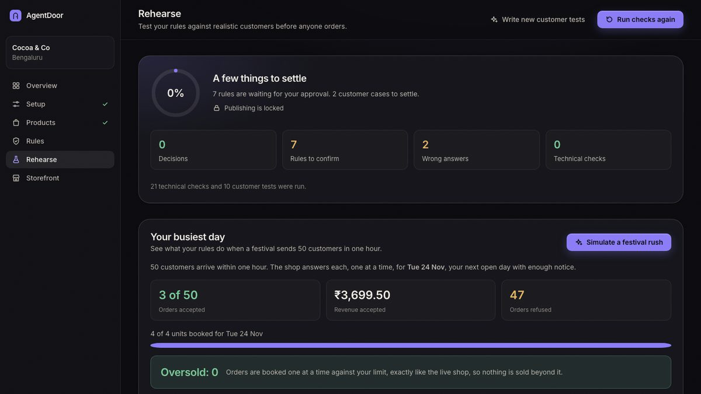

<picture>
  <source media="(prefers-color-scheme: dark)" srcset="assets/hero-dark.svg">
  <source media="(prefers-color-scheme: light)" srcset="assets/hero-light.svg">
  
</picture>

  <a href="#selected-work"><b>Selected work</b></a> &nbsp;·&nbsp;
  <a href="#how-i-build">How I build</a> &nbsp;·&nbsp;
  <a href="#capabilities">Capabilities</a> &nbsp;·&nbsp;
  <a href="https://shroddha-portfolio.vercel.app">Portfolio</a> &nbsp;·&nbsp;
  <a href="https://www.linkedin.com/in/shroddha-ghosh-90b332232/">LinkedIn</a>

I'm a software engineer building AI systems that call real tools, check their own work, and act only within limits enforced in code. I work as a **Software Engineering Specialist at GE Vernova** (Python, SQL, analytics, backend systems) and hold a B.Tech in Computer Science (2024).

My independent work is about agentic applications where a wrong answer costs money: payment-incident investigation, chargeback defense, and storefronts that AI agents can buy from. Start with **[PayOps Sentinel](#payops-sentinel)**, **[AgentDoor](#agentdoor)** (live) and **[DisputeDesk](#disputedesk)**.

## Selected work

### PayOps Sentinel

**A refund-spike investigator that tries to disprove its own explanations before any money moves.**

When refunds spike, payment-ops teams need the real driver, not a plausible story, and any refund the system recommends has to be safe to execute.

- The investigator agent gets read-only tools. The server re-runs exact hypergeometric tests (Bonferroni-corrected, Mantel-Haenszel stratified) against every driver the model names, and checks every number it states against the query it cites.
- Refunds pass 16 deterministic policy checks and an approval bound to a SHA-256 hash of the exact action. They execute once with a stable PayPal request ID, are re-validated before submit, and are verified with PayPal after.
- **Evidence:** on 360 held-out runs, the falsification engine cut false attributions from 26.9% to 2.8% against a share-based baseline. In the frozen evaluation, 84/84 numeric claims matched their source and 16/16 safety cases passed. 158 backend tests; CI on main.

Python · FastAPI · PostgreSQL · SQLAlchemy · Claude · Next.js · AG Grid &nbsp;|&nbsp; PayPal sandbox with real sandbox captures and synthetic history · PayPal AI Hackathon 2026 
[Repository](https://github.com/shro-2002/payops-sentinel) · [Demo video](https://youtu.be/5SXoGS8ZJnE) · [Evaluation](https://github.com/shro-2002/payops-sentinel/blob/main/docs/EVALUATION.md) · [Security model](https://github.com/shro-2002/payops-sentinel/blob/main/docs/SECURITY_MODEL.md)

### AgentDoor

**Owner-approved business rules, rehearsed against tough customers, then served to people and AI agents.**

A home baker describes her business in her own words. AgentDoor turns that into rules she approves one by one, runs simulated customers against them, and launches a storefront with an MCP endpoint that AI shopping agents can order from.

- Claude drafts declarative, schema-validated policy. Nothing goes live until the owner approves each rule, and model output is never executed as code.
- Prices, capacity and refusals are pure functions. A test fails the build if anything outside the setup workspace references a model client, so no model sits in the money path.
- Quotes are Ed25519-signed tokens bound to the policy hash. Orders reserve capacity with a conditional update inside one transaction with a fixed lock order, so a rush cannot oversell.
- **Evidence:** live at [agentdoor.shop](https://agentdoor.shop); its MCP endpoint (Streamable HTTP) serves `get_business_info`, `get_quote` and `place_order`. Unit, property-based and integration tests, plus Playwright and axe end-to-end checks.

TypeScript · Node · Express · Zod · MCP SDK · MySQL · Claude · Vitest · fast-check &nbsp;|&nbsp; Live demo with an illustrative shop: no payments, no real customers · GoDaddy Inclusive Innovation Hackathon 2026 
[Repository](https://github.com/shro-2002/agentdoor) · [Live demo](https://agentdoor.shop) · [Demo video](https://youtu.be/ES2aL0BVhkI) · [Architecture](https://github.com/shro-2002/agentdoor/blob/main/planning/03_ARCHITECTURE.md)

### DisputeDesk

**A chargeback desk where agents draft, code decides, and a person signs the big ones.**

Card-not-present fraud disputes (Visa reason code 10.4) are won or lost on evidence rules, and filing one moves money.

- Three agents work in a shared team chat to gather evidence, draft and file. Visa Compelling Evidence 3.0 eligibility is decided in code; Claude only writes the letter.
- Provable disputes under $500 file automatically. Larger ones wait for the FinOps lead; anyone else's approval is refused and logged.
- The payment gateway verifies an HMAC-SHA256 audit chain before every money call. Receipts are unique per dispute and approval, so replays are rejected.
- **Evidence:** 349 tests, 99 of them attacks on the approval gate: replays, cross-dispute approvals, forged audit rows, mid-chain rewrites. The chain's known limits are written down, not hidden.

Python · FastAPI · SQLite · Claude · Switch (Mattermost) &nbsp;|&nbsp; Mock payment gateway, synthetic disputes · WeMakeDevs Flip the Switch hackathon 
[Repository](https://github.com/shro-2002/disputedesk) · [Demo video (2:43)](https://youtu.be/A_EF8L1ivME) · [Claim audit](https://github.com/shro-2002/disputedesk/blob/main/docs/README_CLAIM_AUDIT.md)

### Also worth a look

**[Half-Life](https://github.com/shro-2002/halflife): facts decay; this tells an AI gateway which answers to re-check, and when.** A verdict counts only if its quote appears verbatim in the cited source. On 108 hand-labelled cases: precision 0.854, recall 0.921. With half the checking budget it catches 83% of stale answers against 69% for a fair random baseline. 160 tests, CI green.
Python · FastAPI · SciPy · MCP · Tavily · [Demo video](https://youtu.be/0BJx83UlPSU)

**[KinSync](https://github.com/shro-2002/KinSync): care handoffs where responsibility moves only when a person approves and the recipient accepts.** Self-hosted MCP server (spec 2025-11-25, Streamable HTTP, origin checks) with an MCP Apps dashboard. The agent boundary is tested against a planner that obeys injected instructions: human-only tools are refused and nothing is written. 236 tests.
TypeScript · MCP SDK · Express · SQLite · Claude &nbsp;|&nbsp; Local prototype, simulated Alexa+ workflow, synthetic data

**[AuditGlimmer](https://github.com/shro-2002/auditglimmer): inspection photos to traceable lending-collateral evidence.** SAM 3.1 segments equipment and Muse Spark reads serials; the reading model never sees the asset register, and tiered rules name the reason for every match. Pre-registered study: 11/16 exact serials (69%), just below its own 70% bar, and 0 serials invented on 8 negatives. 144 backend tests.
Python · FastAPI · Next.js · SAM 3.1 · Muse Spark &nbsp;|&nbsp; Local prototype · [Demo video (2:55)](https://youtu.be/xvGoop1LOUE)

**More:**
[RewardShield](https://github.com/shro-2002/rewardshield) measures how often SQL execution rewards accept wrong queries; I reported the underlying reward bug upstream ([AgentTune #20](https://github.com/Lexsi-Labs/AgentTune/issues/20)) and my fix commit shipped in the merged [PR #22](https://github.com/Lexsi-Labs/AgentTune/pull/22) ·
[Metric Mirage](https://github.com/shro-2002/metric-mirage) flags when an overall rate rises while every group falls, using exact-fraction decomposition ([live](https://shro-2002.github.io/metric-mirage/)) ·
[AcceptGuard](https://github.com/shro-2002/acceptguard) rebuilds MSME payment deadlines from delivery evidence for accountant review ([live](https://acceptguard.onrender.com)) ·
[AmanShift](https://github.com/shro-2002/amanshift) plans heat protection for outdoor crews that only gets stricter when data disappears ([live](https://amanshift.onrender.com)) ·
[Countersign](https://github.com/shro-2002/countersign) limits agent refunds to what the merchant authorized, checked against PayPal's live record

Every project above is a prototype, sandbox or demo build; none is a production deployment, and no hackathon result is claimed. I use AI coding assistants for much of the implementation. My part is scoping, architecture, controls, reviewing the code, defining the tests and evaluations, and deciding what ships.

## How I build

**The model proposes. Code enforces the limits. Evidence checks the result. A person signs off on anything that moves money or can't be undone.**

- **Models get narrow tools.** Read-only, argument-validated, budgeted. No raw SQL, no generated code executed.
- **Rules live in code, not prompts.** Pricing, eligibility, and refund policy are deterministic functions with tests.
- **Every claim is checkable.** Numbers trace to the query that produced them. Unsupported claims are flagged, not shown.
- **Money paths are boring on purpose.** Idempotency keys, unique constraints, single-use approvals, verification after the write.
- **Results are reported as counts, including the failures.** Frozen and held-out evaluations; misses stay in the write-up.

## Capabilities

| Area | What I work with |
|---|---|
| **Agent systems** | Tool calling with read-only, validated tools · multi-agent workflows · MCP servers (Streamable HTTP) · structured outputs · Claude and Gemini APIs |
| **Backend and APIs** | Python · FastAPI · Pydantic · SQLAlchemy · TypeScript · Node · Express · Zod · Next.js · React |
| **Evaluation and testing** | Frozen and held-out eval sets · pre-registered studies · exact statistical tests · pytest · Vitest · property-based testing · Playwright |
| **Security and reliability** | Policy engines · idempotency and unique constraints · Ed25519 signing · HMAC and SHA-256 hash chains · approval bound to an action hash · prompt-injection tests |
| **Data and infrastructure** | SQL · PostgreSQL · MySQL · SQLite · pandas · NumPy · SciPy · PyTorch · Docker · GitHub Actions |

## Connect

[Portfolio](https://shroddha-portfolio.vercel.app) · [LinkedIn](https://www.linkedin.com/in/shroddha-ghosh-90b332232/) · [X](https://x.com/shrobuilds) · [All repositories](https://github.com/shro-2002?tab=repositories)
