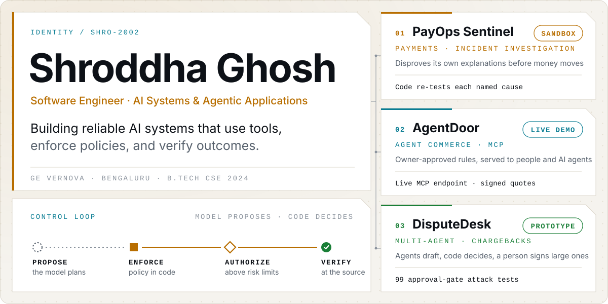
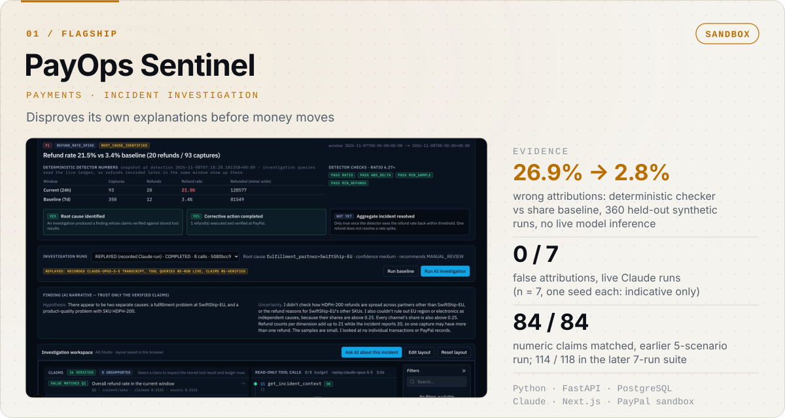
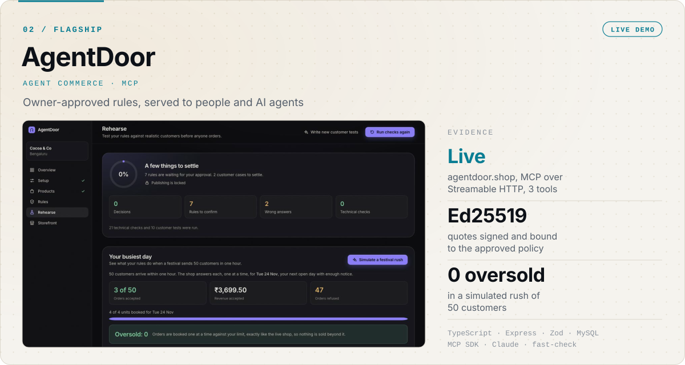
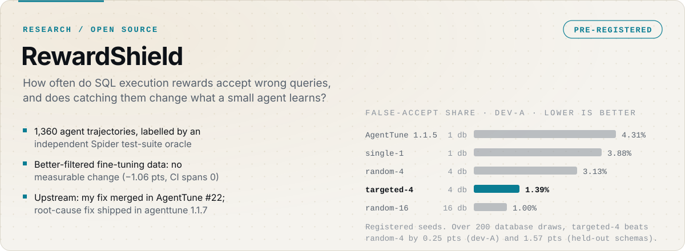

<picture>
  <source media="(max-width: 640px) and (prefers-color-scheme: dark)" srcset="assets/hero-mobile-dark.svg">
  <source media="(max-width: 640px)" srcset="assets/hero-mobile-light.svg">
  <source media="(prefers-color-scheme: dark)" srcset="assets/hero-dark.svg">
  
</picture>

  
  
  

  <a href="#selected-work"><b>Selected work</b></a> &nbsp;·&nbsp;
  <a href="#research-and-supporting-work"><b>Research</b></a> &nbsp;·&nbsp;
  <a href="#engineering-activity">Activity</a> &nbsp;·&nbsp;
  <a href="#how-i-build">How I build</a> &nbsp;·&nbsp;
  <a href="https://shroddha-portfolio.vercel.app">Portfolio</a> &nbsp;·&nbsp;
  <a href="https://www.linkedin.com/in/shroddha-ghosh-90b332232/">LinkedIn</a>

**From model output to verified action.** I build AI systems that call real tools, check their own work, and act only within limits enforced in code: payment-incident investigation, chargeback defense, and storefronts AI agents can buy from. I work as a **Software Engineering Specialist at GE Vernova**, building backend systems and data analytics with Python and SQL. B.Tech in Computer Science, 2024.

> **Scope of everything below.** These are prototypes, sandbox integrations and live demos, built between mid-October and November 2026, the flagships as hackathon entries. None is a production deployment with real users, and no hackathon result is claimed. I use AI coding assistants for much of the implementation; my part is scoping, architecture, controls, reviewing the code, defining the tests and evaluations, and deciding what ships.

## Selected work

### PayOps Sentinel

<picture>
  <source media="(max-width: 640px) and (prefers-color-scheme: dark)" srcset="assets/covers/payops-mobile-dark.svg">
  <source media="(max-width: 640px)" srcset="assets/covers/payops-mobile-light.svg">
  <source media="(prefers-color-scheme: dark)" srcset="assets/covers/payops-dark.svg">
  
</picture>

**[Repository](https://github.com/shro-2002/payops-sentinel) · [Demo video](https://youtu.be/5SXoGS8ZJnE) · [Evaluation](https://github.com/shro-2002/payops-sentinel/blob/main/docs/EVALUATION.md) · [Security model](https://github.com/shro-2002/payops-sentinel/blob/main/docs/SECURITY_MODEL.md)**

- **Falsification, not narration.** The agent gets read-only tools; the server re-runs exact statistical tests (hypergeometric, Bonferroni-corrected, Mantel-Haenszel stratified) on every driver it names and checks every number against the query it cites.
- **Refunds behind a gate.** 16 deterministic policy checks, a human approval bound to a SHA-256 hash of the exact action, one execution with a stable PayPal request ID, re-validated before submit and verified after. 16 of 16 safety cases pass with no unauthorized execution; 158 backend tests run in CI.
- **What the numbers cover.** 26.9% → 2.8% wrong attributions compares two pieces of deterministic code, the checker and a share-of-excess baseline, on 360 held-out synthetic runs each. No model runs in that comparison, and the checker pays for it by abstaining in 9.3% of runs where a cause exists. With a live model the sample is small: 7 runs per protocol, 0 false attributions under the current one, 114 of 118 numeric claims matching their source. The 84 of 84 figure is from an earlier 5-scenario run.

**Scope:** PayPal sandbox, real sandbox captures, synthetic history written by me. PayPal AI Hackathon 2026.

### AgentDoor

<picture>
  <source media="(max-width: 640px) and (prefers-color-scheme: dark)" srcset="assets/covers/agentdoor-mobile-dark.svg">
  <source media="(max-width: 640px)" srcset="assets/covers/agentdoor-mobile-light.svg">
  <source media="(prefers-color-scheme: dark)" srcset="assets/covers/agentdoor-dark.svg">
  
</picture>

**[Live demo](https://agentdoor.shop) · [Repository](https://github.com/shro-2002/agentdoor) · [Demo video](https://youtu.be/ES2aL0BVhkI) · [Architecture](https://github.com/shro-2002/agentdoor/blob/main/planning/03_ARCHITECTURE.md)**

- **No model in the money path.** Claude drafts declarative, schema-validated policy and nothing goes live until the owner approves each rule. Prices, capacity and refusals are pure functions; a test fails if code outside the setup workspace references a model client.
- **Orders that cannot oversell.** Each order reserves capacity with a conditional update inside one transaction with a fixed lock order. Unit, property-based, integration and Playwright + axe tests.

**Scope:** illustrative shop, no payments, no real customers. GoDaddy Inclusive Innovation Hackathon 2026.

### DisputeDesk

<picture>
  <source media="(max-width: 640px) and (prefers-color-scheme: dark)" srcset="assets/covers/disputedesk-mobile-dark.svg">
  <source media="(max-width: 640px)" srcset="assets/covers/disputedesk-mobile-light.svg">
  <source media="(prefers-color-scheme: dark)" srcset="assets/covers/disputedesk-dark.svg">
  
</picture>

**[Repository](https://github.com/shro-2002/disputedesk) · [Demo video (2:43)](https://youtu.be/A_EF8L1ivME) · [Claim audit](https://github.com/shro-2002/disputedesk/blob/main/docs/README_CLAIM_AUDIT.md)**

- **Eligibility in code.** Three agents gather evidence, draft and file in a shared team chat (Visa reason code 10.4). Compelling Evidence 3.0 eligibility is decided in code; Claude only writes the letter.
- **Approval scales with risk.** Provable disputes under $500 file automatically; above that only the FinOps lead can approve, and anyone else is refused and logged. Receipts are unique per dispute and approval, so replays fail. The chain's known limits are written down, not hidden.

**Scope:** mock payment gateway, synthetic disputes. WeMakeDevs Flip the Switch hackathon.

## Research and supporting work

### RewardShield

<picture>
  <source media="(max-width: 640px) and (prefers-color-scheme: dark)" srcset="assets/covers/rewardshield-mobile-dark.svg">
  <source media="(max-width: 640px)" srcset="assets/covers/rewardshield-mobile-light.svg">
  <source media="(prefers-color-scheme: dark)" srcset="assets/covers/rewardshield-dark.svg">
  
</picture>

**[Repository](https://github.com/shro-2002/rewardshield) · [Results](https://github.com/shro-2002/rewardshield/blob/main/RESULTS.md) · [Pre-registration](https://github.com/shro-2002/rewardshield/blob/main/HYPOTHESES.md) · [Upstream outcome](https://github.com/shro-2002/rewardshield/blob/main/reports/upstream/OUTCOME.md)**

A pre-registered study on Tiny Aya Global (3B) with LoRA fine-tuning in TRL, over 1,360 agent trajectories labelled by an independent Spider test-suite oracle. Better-filtered fine-tuning data made no measurable change (−1.06 pts, interval spans zero).

Upstream: I reported that AgentTune's shipped SQL reward scored every Tiny Aya rollout −1 ([issue #20](https://github.com/Lexsi-Labs/AgentTune/issues/20)) and opened [PR #21](https://github.com/Lexsi-Labs/AgentTune/pull/21) with two fixes.

- **Accepted:** my column-order fix, merged under my authorship. The maintainers added pruning so wide results stay fast.
- **Superseded:** my workaround for the −1 defect. The maintainers showed it could be forged through a crafted tool name, removed it and fixed the cause in the rollout. My tests had missed that.
- **Maintainers' work:** their broader [PR #22](https://github.com/Lexsi-Labs/AgentTune/pull/22), released as agenttune 1.1.7. It carries the root-cause fix, the points my issue raised but did not patch (float tolerance, row order, the score-log write, comparison databases) and further defects they found themselves.

### More systems

**[Half-Life](https://github.com/shro-2002/halflife): tells an AI gateway which stored answers to re-check first.** A verdict counts only if its quote appears verbatim in the cited source. On 108 cases labelled by one annotator: precision 0.854, recall 0.921, and 13% of current claims wrongly flagged as changed. Re-checking half the claims, ordered by the model's outdated-probability, catches 83% of stale claims against 69% for a fair random baseline; the half-life decay model itself showed no measurable lift, and the README reports it. 160 tests, CI green.
Python · FastAPI · SciPy · MCP · Tavily &nbsp;·&nbsp; [Demo video](https://youtu.be/0BJx83UlPSU)

**[AuditGlimmer](https://github.com/shro-2002/auditglimmer): inspection photos to traceable lending-collateral evidence.** SAM 3.1 segments equipment and Muse Spark reads serials; the reading model never sees the asset register, and tiered rules name the reason for every match. Pre-registered study: 11/16 exact serials (69%), just below its own 70% bar, and 0 serials invented on 8 negatives. 144 backend tests. Local prototype.
Python · FastAPI · Next.js · SAM 3.1 · Muse Spark &nbsp;·&nbsp; [Demo video (2:55)](https://youtu.be/xvGoop1LOUE)

**Smaller builds**

- **[KinSync](https://github.com/shro-2002/KinSync)**: care handoffs where responsibility moves only when a person approves and the recipient accepts. Self-hosted MCP server (spec 2025-11-25, Streamable HTTP, origin checks) tested against a planner that obeys injected instructions; 236 tests. Local prototype, simulated Alexa+ workflow.
- **[Metric Mirage](https://github.com/shro-2002/metric-mirage)**: flags when an overall rate rises while every group falls, using exact-fraction decomposition ([live](https://shro-2002.github.io/metric-mirage/)).
- **[AcceptGuard](https://github.com/shro-2002/acceptguard)**: rebuilds MSME payment deadlines from delivery evidence for accountant review ([live](https://acceptguard.onrender.com)).
- **[AmanShift](https://github.com/shro-2002/amanshift)**: heat-protection plans for outdoor crews that only get stricter when data disappears ([live](https://amanshift.onrender.com)).
- **[Countersign](https://github.com/shro-2002/countersign)**: limits agent refunds to what the merchant authorized, checked against PayPal's record of the payment.

## Engineering activity

<!-- activity:start -->
<picture>
  <source media="(max-width: 640px) and (prefers-color-scheme: dark)" srcset="assets/activity/activity-mobile-dark.svg">
  <source media="(max-width: 640px)" srcset="assets/activity/activity-mobile-light.svg">
  <source media="(prefers-color-scheme: dark)" srcset="assets/activity/activity-dark.svg">
  
</picture>

**Recently shipping**

- **2026-11-15 · Upstream PR merged** · [Lexsi-Labs/AgentTune\#21](https://github.com/Lexsi-Labs/AgentTune/pull/21): fix: result\_match\_reward reads folded tool results and accepts reordered columns
- **2026-11-28 · Commit** · [engineering-lab](https://github.com/shro-2002/engineering-lab/commit/20bb3f37d8304cc8ad22b78bed4aebddabc9ba5f): data(observations): daily measurements and health report 2026-11-28
- **2026-11-21 · Commit** · [acceptguard](https://github.com/shro-2002/acceptguard/commit/e93e4f5c122c43559cdad5f33d240d9a8681ea51): fix(verify): drop the quoted-region exemption from the medium check
- **2026-11-20 · Commit** · [agentdoor](https://github.com/shro-2002/agentdoor/commit/7c4797fa1d256290d608bf00a352d3b32890a4b9): fix: release hardening from the final submission audit

The chart covers Oct 4 – Nov 28, 2026 only; those weeks hold 403 of my 405 public contributions in the last 12 months, and GitHub's own graph under this README shows the full year. Rebuilt daily by the [activity workflow](.github/workflows/activity.yml) from public GitHub data; pull requests to this profile repository, housekeeping commits and bot commits are left out. Data as of 2026-11-28.
<!-- activity:end -->

## How I build

**Models propose. Code enforces policy. People set the limits and approve what falls outside them. Outcomes are checked, not assumed.**

- **Model output is a proposal.** A hypothesis, a draft letter, a policy to approve. Generated code is never executed.
- **Investigating and acting are separate.** Investigation tools are read-only and argument-validated. Anything that acts (a refund, a dispute filing, an order) runs through deterministic policy checks, and above risk limits a person's approval, before it executes.
- **Policy lives in code.** Pricing, eligibility and refund rules are deterministic functions with tests, not prompt instructions.
- **Results are reported as counts, failures included.** Pre-registered hypotheses, held-out sets, intervals, and the misses kept in the write-up.

## Capabilities

| Area | What I work with |
|---|---|
| **Agent systems** | Tool calling · multi-agent workflows · MCP servers (Streamable HTTP) · structured outputs · Claude and Gemini APIs |
| **Backend and APIs** | Python · FastAPI · Pydantic · SQLAlchemy |
| **Evaluation and fine-tuning** | Frozen and held-out eval sets · pre-registered studies · exact statistical tests and bootstrap intervals · LoRA SFT with TRL · pytest · Vitest · property-based testing · Playwright |
| **Security and reliability** | Policy engines · idempotency and unique constraints · Ed25519 signing · HMAC and SHA-256 hash chains · approval bound to an action hash · prompt-injection tests |
| **Data and infrastructure** | SQL · PostgreSQL · MySQL · SQLite · pandas · NumPy · SciPy · PyTorch · Docker · GitHub Actions |

## Connect

[Portfolio](https://shroddha-portfolio.vercel.app) · [LinkedIn](https://www.linkedin.com/in/shroddha-ghosh-90b332232/) · [X](https://x.com/shrobuilds) · [All repositories](https://github.com/shro-2002?tab=repositories)
