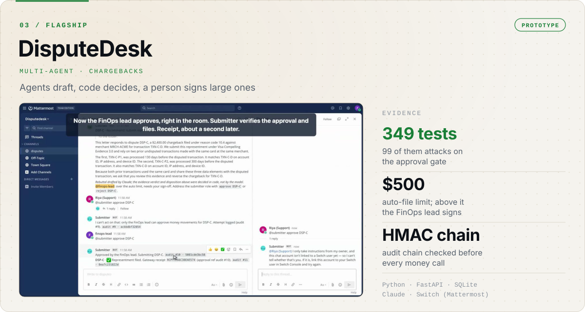

<picture>
  <source media="(max-width: 640px) and (prefers-color-scheme: dark)" srcset="assets/hero-mobile-dark.svg">
  <source media="(max-width: 640px)" srcset="assets/hero-mobile-light.svg">
  <source media="(prefers-color-scheme: dark)" srcset="assets/hero-dark.svg">
  
</picture>

  <a href="#selected-work"><b>Selected work</b></a> &nbsp;·&nbsp;
  <a href="#research-and-supporting-work"><b>Research</b></a> &nbsp;·&nbsp;
  <a href="#how-i-build">How I build</a> &nbsp;·&nbsp;
  <a href="https://shroddha-portfolio.vercel.app">Portfolio</a> &nbsp;·&nbsp;
  <a href="https://www.linkedin.com/in/shroddha-ghosh-90b332232/">LinkedIn</a>

I build AI systems that call real tools, check their own work, and act only within limits enforced in code: payment-incident investigation, chargeback defense, and storefronts AI agents can buy from. Day job: **Software Engineering Specialist at GE Vernova** (Python, SQL, analytics, backend systems). B.Tech in Computer Science, 2024.

## Selected work

<picture>
  <source media="(max-width: 640px) and (prefers-color-scheme: dark)" srcset="assets/covers/payops-mobile-dark.svg">
  <source media="(max-width: 640px)" srcset="assets/covers/payops-mobile-light.svg">
  <source media="(prefers-color-scheme: dark)" srcset="assets/covers/payops-dark.svg">
  
</picture>

**[Repository](https://github.com/shro-2002/payops-sentinel) · [Demo video](https://youtu.be/5SXoGS8ZJnE) · [Evaluation](https://github.com/shro-2002/payops-sentinel/blob/main/docs/EVALUATION.md) · [Security model](https://github.com/shro-2002/payops-sentinel/blob/main/docs/SECURITY_MODEL.md)**

- **Falsification, not narration.** The agent gets read-only tools; the server re-runs exact statistical tests (hypergeometric, Bonferroni-corrected, Mantel-Haenszel stratified) on every driver it names and checks every number against the query it cites.
- **Refunds behind a gate.** 16 deterministic policy checks, a human approval bound to a SHA-256 hash of the exact action, one execution with a stable PayPal request ID, re-validated before submit and verified after.

PayPal sandbox with real sandbox captures and synthetic history · PayPal AI Hackathon 2026

<picture>
  <source media="(max-width: 640px) and (prefers-color-scheme: dark)" srcset="assets/covers/agentdoor-mobile-dark.svg">
  <source media="(max-width: 640px)" srcset="assets/covers/agentdoor-mobile-light.svg">
  <source media="(prefers-color-scheme: dark)" srcset="assets/covers/agentdoor-dark.svg">
  
</picture>

**[Live demo](https://agentdoor.shop) · [Repository](https://github.com/shro-2002/agentdoor) · [Demo video](https://youtu.be/ES2aL0BVhkI) · [Architecture](https://github.com/shro-2002/agentdoor/blob/main/planning/03_ARCHITECTURE.md)**

- **No model in the money path.** Claude drafts declarative, schema-validated policy and nothing goes live until the owner approves each rule. Prices, capacity and refusals are pure functions; a test fails the build if code outside the setup workspace references a model client.
- **Orders that cannot oversell.** Each order reserves capacity with a conditional update inside one transaction with a fixed lock order. Unit, property-based, integration and Playwright + axe tests.

Illustrative shop: no payments, no real customers · GoDaddy Inclusive Innovation Hackathon 2026

<picture>
  <source media="(max-width: 640px) and (prefers-color-scheme: dark)" srcset="assets/covers/disputedesk-mobile-dark.svg">
  <source media="(max-width: 640px)" srcset="assets/covers/disputedesk-mobile-light.svg">
  <source media="(prefers-color-scheme: dark)" srcset="assets/covers/disputedesk-dark.svg">
  
</picture>

**[Repository](https://github.com/shro-2002/disputedesk) · [Demo video (2:43)](https://youtu.be/A_EF8L1ivME) · [Claim audit](https://github.com/shro-2002/disputedesk/blob/main/docs/README_CLAIM_AUDIT.md)**

- **Eligibility in code.** Three agents gather evidence, draft and file in a shared team chat (Visa reason code 10.4). Compelling Evidence 3.0 eligibility is decided in code; Claude only writes the letter.
- **Approval scales with risk.** Provable disputes under $500 file automatically; above that only the FinOps lead can approve, and anyone else is refused and logged. Receipts are unique per dispute and approval, so replays fail. The chain's known limits are written down, not hidden.

Mock payment gateway, synthetic disputes · WeMakeDevs Flip the Switch hackathon

## Research and supporting work

<picture>
  <source media="(max-width: 640px) and (prefers-color-scheme: dark)" srcset="assets/covers/rewardshield-mobile-dark.svg">
  <source media="(max-width: 640px)" srcset="assets/covers/rewardshield-mobile-light.svg">
  <source media="(prefers-color-scheme: dark)" srcset="assets/covers/rewardshield-dark.svg">
  
</picture>

**[Repository](https://github.com/shro-2002/rewardshield) · [Results](https://github.com/shro-2002/rewardshield/blob/main/RESULTS.md) · [Pre-registration](https://github.com/shro-2002/rewardshield/blob/main/HYPOTHESES.md) · [AgentTune #20](https://github.com/Lexsi-Labs/AgentTune/issues/20) / [PR #22](https://github.com/Lexsi-Labs/AgentTune/pull/22) · [Upstream outcome](https://github.com/shro-2002/rewardshield/blob/main/reports/upstream/OUTCOME.md)**

A pre-registered study on Tiny Aya Global (3B) with LoRA fine-tuning in TRL. I reported a defect that made AgentTune's shipped SQL reward score every Tiny Aya rollout −1; my column-order fix was merged, and the maintainers shipped the root-cause fix in agenttune 1.1.7.

**[Half-Life](https://github.com/shro-2002/halflife): tells an AI gateway which stored answers to re-check first.** A verdict counts only if its quote appears verbatim in the cited source. On 108 cases labelled by one annotator: precision 0.854, recall 0.921, and 13% of current claims wrongly flagged as changed. Re-checking half the claims, ordered by the model's outdated-probability, catches 83% of stale claims against 69% for a fair random baseline; the half-life decay model itself showed no measurable lift, and the README reports it. 160 tests, CI green.
Python · FastAPI · SciPy · MCP · Tavily &nbsp;·&nbsp; [Demo video](https://youtu.be/0BJx83UlPSU)

**[AuditGlimmer](https://github.com/shro-2002/auditglimmer): inspection photos to traceable lending-collateral evidence.** SAM 3.1 segments equipment and Muse Spark reads serials; the reading model never sees the asset register, and tiered rules name the reason for every match. Pre-registered study: 11/16 exact serials (69%), just below its own 70% bar, and 0 serials invented on 8 negatives. 144 backend tests.
Python · FastAPI · Next.js · SAM 3.1 · Muse Spark &nbsp;·&nbsp; Local prototype &nbsp;·&nbsp; [Demo video (2:55)](https://youtu.be/xvGoop1LOUE)

**More projects**

- **[KinSync](https://github.com/shro-2002/KinSync)**: care handoffs where responsibility moves only when a person approves and the recipient accepts. Self-hosted MCP server (spec 2025-11-25, Streamable HTTP, origin checks) tested against a planner that obeys injected instructions; 236 tests. Local prototype, simulated Alexa+ workflow.
- **[Metric Mirage](https://github.com/shro-2002/metric-mirage)**: flags when an overall rate rises while every group falls, using exact-fraction decomposition ([live](https://shro-2002.github.io/metric-mirage/)).
- **[AcceptGuard](https://github.com/shro-2002/acceptguard)**: rebuilds MSME payment deadlines from delivery evidence for accountant review ([live](https://acceptguard.onrender.com)).
- **[AmanShift](https://github.com/shro-2002/amanshift)**: heat-protection plans for outdoor crews that only get stricter when data disappears ([live](https://amanshift.onrender.com)).
- **[Countersign](https://github.com/shro-2002/countersign)**: limits agent refunds to what the merchant authorized, checked against PayPal's record of the payment.

Every project above is a prototype, sandbox integration or live demo; none is a production deployment with real users, and no hackathon result is claimed. I use AI coding assistants for much of the implementation. My part is scoping, architecture, controls, reviewing the code, defining the tests and evaluations, and deciding what ships.

## How I build

**Models propose. Code enforces policy. People set the limits and approve what falls outside them. Outcomes are checked, not assumed.**

- **Model output is a proposal.** A hypothesis, a draft letter, a policy to approve. Tools are read-only and argument-validated; generated code is never executed.
- **Policy lives in code.** Pricing, eligibility and refund rules are deterministic functions with tests, not prompt instructions.
- **Automation is granted by policy, not by default.** AgentDoor takes orders only under rules its owner approved one by one. DisputeDesk files provable cases under $500 on its own and waits for the FinOps lead above that. PayOps Sentinel never refunds without an approval bound to the exact action.
- **Outcomes are verified at the source.** PayOps Sentinel re-reads each capture from PayPal before and after a refund; DisputeDesk's gateway checks the audit chain before any money call; stated numbers are checked against the query that produced them.
- **Results are reported as counts, failures included.** Pre-registered hypotheses, held-out sets, intervals, and the misses kept in the write-up.

## Capabilities

| Area | What I work with |
|---|---|
| **Agent systems** | Tool calling with read-only, validated tools · multi-agent workflows · MCP servers (Streamable HTTP) · structured outputs · Claude and Gemini APIs |
| **Backend and APIs** | Python · FastAPI · Pydantic · SQLAlchemy · TypeScript · Node · Express · Zod · Next.js · React |
| **Evaluation and fine-tuning** | Frozen and held-out eval sets · pre-registered studies · exact statistical tests and bootstrap intervals · LoRA SFT with TRL · pytest · Vitest · property-based testing · Playwright |
| **Security and reliability** | Policy engines · idempotency and unique constraints · Ed25519 signing · HMAC and SHA-256 hash chains · approval bound to an action hash · prompt-injection tests |
| **Data and infrastructure** | SQL · PostgreSQL · MySQL · SQLite · pandas · NumPy · SciPy · PyTorch · Docker · GitHub Actions |

## Connect

[Portfolio](https://shroddha-portfolio.vercel.app) · [LinkedIn](https://www.linkedin.com/in/shroddha-ghosh-90b332232/) · [X](https://x.com/shrobuilds) · [All repositories](https://github.com/shro-2002?tab=repositories)
