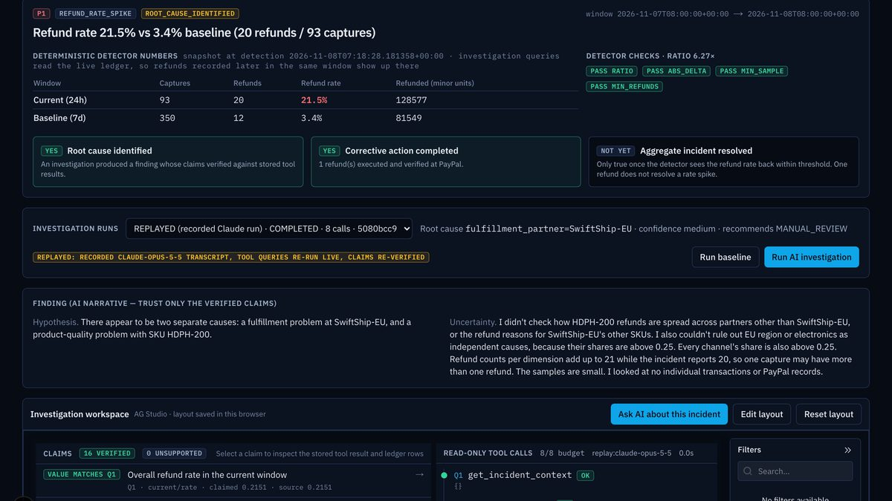
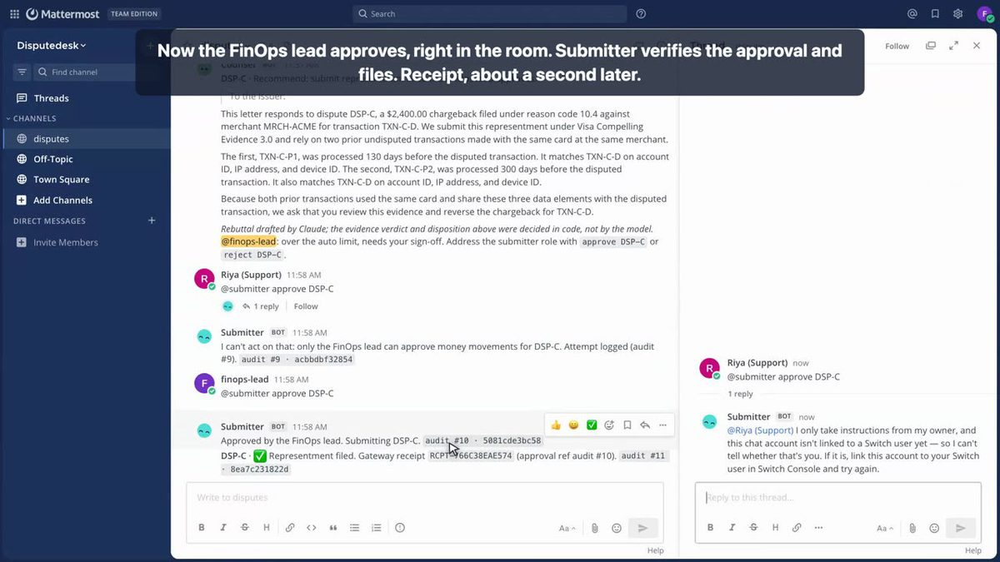

<picture>
  <source media="(max-width: 640px) and (prefers-color-scheme: dark)" srcset="assets/hero-mobile-dark.svg">
  <source media="(max-width: 640px)" srcset="assets/hero-mobile-light.svg">
  <source media="(prefers-color-scheme: dark)" srcset="assets/hero-dark.svg">
  <source media="(prefers-color-scheme: light)" srcset="assets/hero-light.svg">
  
</picture>

  <a href="#selected-work"><b>Selected work</b></a> &nbsp;·&nbsp;
  <a href="#research-and-supporting-work">Research</a> &nbsp;·&nbsp;
  <a href="#how-i-build">How I build</a> &nbsp;·&nbsp;
  <a href="https://shroddha-portfolio.vercel.app">Portfolio</a> &nbsp;·&nbsp;
  <a href="https://www.linkedin.com/in/shroddha-ghosh-90b332232/">LinkedIn</a>

I'm a software engineer building AI systems that call real tools, check their own work, and act only within limits enforced in code. I work as a **Software Engineering Specialist at GE Vernova** (Python, SQL, analytics, backend systems) and hold a B.Tech in Computer Science (2024).

My independent work is about agentic applications where a wrong answer costs money: payment-incident investigation, chargeback defense, and storefronts that AI agents can buy from. Start with **[PayOps Sentinel](#payops-sentinel)**, **[AgentDoor](#agentdoor)** (live) and **[DisputeDesk](#disputedesk)**; for evaluation research, **[RewardShield](#research-and-supporting-work)**.

## Selected work

### PayOps Sentinel

**A refund-spike investigator that tries to disprove its own explanations before any money moves.**

**[Repository](https://github.com/shro-2002/payops-sentinel) · [Demo video](https://youtu.be/5SXoGS8ZJnE) · [Evaluation](https://github.com/shro-2002/payops-sentinel/blob/main/docs/EVALUATION.md) · [Security model](https://github.com/shro-2002/payops-sentinel/blob/main/docs/SECURITY_MODEL.md)**

When refunds spike, payment-ops teams need the real driver, not a plausible story, and any refund the system recommends has to be safe to execute.

- **Falsification, not narration.** The agent gets read-only tools. The server re-runs exact statistical tests (hypergeometric, Bonferroni-corrected, Mantel-Haenszel stratified) on every driver the model names, and checks every number it states against the query it cites.
- **Refunds behind a gate.** 16 deterministic policy checks and a human approval bound to a SHA-256 hash of the exact action. A refund executes once with a stable PayPal request ID, is re-validated with PayPal before submit and verified after.
- **Evidence:** on 360 held-out runs, false attributions fell from 26.9% (share-based baseline) to 2.8%. In the frozen evaluation, 84/84 numeric claims matched their source and 16/16 safety cases passed. 158 backend tests; CI on main.

**Status:** PayPal sandbox integration with real sandbox captures and synthetic history &nbsp;·&nbsp; Python · FastAPI · PostgreSQL · SQLAlchemy · Claude · Next.js · AG Grid &nbsp;·&nbsp; PayPal AI Hackathon 2026

### AgentDoor

**Owner-approved business rules, rehearsed against simulated customers, then served to people and AI agents.**

**[Live demo](https://agentdoor.shop) · [Repository](https://github.com/shro-2002/agentdoor) · [Demo video](https://youtu.be/ES2aL0BVhkI) · [Architecture](https://github.com/shro-2002/agentdoor/blob/main/planning/03_ARCHITECTURE.md)**

A home baker describes the business in their own words. AgentDoor turns that into rules the owner approves one by one, rehearses them against simulated customers, and launches a storefront with an MCP endpoint that AI shopping agents can order from.

- **No model in the money path.** Claude drafts declarative, schema-validated policy, and nothing goes live until the owner approves each rule. Prices, capacity and refusals are pure functions; a test fails the build if code outside the setup workspace references a model client.
- **Orders that cannot oversell.** Quotes are Ed25519-signed tokens bound to the policy hash. Each order reserves capacity with a conditional update inside one transaction with a fixed lock order.
- **Evidence:** live at [agentdoor.shop](https://agentdoor.shop); its MCP endpoint (Streamable HTTP) serves `get_business_info`, `get_quote` and `place_order`. Unit, property-based and integration tests, plus Playwright and axe end-to-end checks.

**Status:** live demo with an illustrative shop; no payments, no real customers &nbsp;·&nbsp; TypeScript · Node · Express · Zod · MCP SDK · MySQL · Claude · Vitest · fast-check &nbsp;·&nbsp; GoDaddy Inclusive Innovation Hackathon 2026

### DisputeDesk

**A chargeback desk where agents draft, code decides, and a person signs the large ones.**

**[Repository](https://github.com/shro-2002/disputedesk) · [Demo video (2:43)](https://youtu.be/A_EF8L1ivME) · [Claim audit](https://github.com/shro-2002/disputedesk/blob/main/docs/README_CLAIM_AUDIT.md)**

Card-not-present fraud disputes (Visa reason code 10.4) are won or lost on evidence rules, and filing one moves money.

- **Eligibility in code.** Three agents gather evidence, draft and file in a shared team chat. Visa Compelling Evidence 3.0 eligibility is decided in code; Claude only writes the letter.
- **Approval scales with risk.** Provable disputes under $500 file automatically; larger ones wait for the FinOps lead, and anyone else's approval is refused and logged. The gateway verifies an HMAC-SHA256 audit chain before every money call, and receipts are unique per dispute and approval.
- **Evidence:** 349 tests, 99 of them attacks on the approval gate: replays, cross-dispute approvals, forged audit rows, mid-chain rewrites. The chain's known limits are written down, not hidden.

**Status:** prototype with a mock payment gateway and synthetic disputes &nbsp;·&nbsp; Python · FastAPI · SQLite · Claude · Switch (Mattermost) &nbsp;·&nbsp; WeMakeDevs Flip the Switch hackathon

## Research and supporting work

**[RewardShield](https://github.com/shro-2002/rewardshield): how often SQL execution rewards accept wrong queries, and whether catching them changes what a small agent learns.** A pre-registered study on Tiny Aya Global (3B): five verifiers compared on 1,360 agent trajectories, labelled by an independent Spider test-suite oracle. Checking each reward on 4 mutation-targeted databases cut the false-accept share from 3.88% to 1.39%; averaged over 200 database draws, its edge over 4 random databases is small (−0.25 points on the audit split, −1.57 on held-out schemas). Filtering LoRA fine-tuning data with the better verifier made no measurable difference (−1.06 points, interval spans zero), and the write-up says so. Upstream, I reported a defect that made AgentTune's shipped SQL reward score every Tiny Aya rollout −1 ([issue #20](https://github.com/Lexsi-Labs/AgentTune/issues/20)); my column-order fix was merged in [PR #22](https://github.com/Lexsi-Labs/AgentTune/pull/22), and the maintainers released a root-cause fix in agenttune 1.1.7.
Python · TRL · LoRA · SQLite · AgentTune · AuditKIT · Kaggle T4 &nbsp;·&nbsp; [Results](https://github.com/shro-2002/rewardshield/blob/main/RESULTS.md) · [Pre-registration](https://github.com/shro-2002/rewardshield/blob/main/HYPOTHESES.md) · [Upstream outcome](https://github.com/shro-2002/rewardshield/blob/main/reports/upstream/OUTCOME.md)

**[Half-Life](https://github.com/shro-2002/halflife): tells an AI gateway which stored answers to re-check first.** A verdict counts only if its quote appears verbatim in the cited source. On 108 cases labelled by one annotator: precision 0.854, recall 0.921, and 13% of current claims wrongly flagged as changed. Re-checking half the claims, ordered by the model's outdated-probability, catches 83% of stale claims against 69% for a fair random baseline; the half-life decay model itself showed no measurable lift, and the README reports it. 160 tests, CI green.
Python · FastAPI · SciPy · MCP · Tavily &nbsp;·&nbsp; [Demo video](https://youtu.be/0BJx83UlPSU)

**[AuditGlimmer](https://github.com/shro-2002/auditglimmer): inspection photos to traceable lending-collateral evidence.** SAM 3.1 segments equipment and Muse Spark reads serials; the reading model never sees the asset register, and tiered rules name the reason for every match. Pre-registered study: 11/16 exact serials (69%), just below its own 70% bar, and 0 serials invented on 8 negatives. 144 backend tests.
Python · FastAPI · Next.js · SAM 3.1 · Muse Spark &nbsp;·&nbsp; Local prototype &nbsp;·&nbsp; [Demo video (2:55)](https://youtu.be/xvGoop1LOUE)

**More projects**

- **[KinSync](https://github.com/shro-2002/KinSync)**: care handoffs where responsibility moves only when a person approves and the recipient accepts. Self-hosted MCP server (spec 2025-11-25, Streamable HTTP, origin checks) tested against a planner that obeys injected instructions; 236 tests. Local prototype, simulated Alexa+ workflow.
- **[Metric Mirage](https://github.com/shro-2002/metric-mirage)**: flags when an overall rate rises while every group falls, using exact-fraction decomposition ([live](https://shro-2002.github.io/metric-mirage/)).
- **[AcceptGuard](https://github.com/shro-2002/acceptguard)**: rebuilds MSME payment deadlines from delivery evidence for accountant review ([live](https://acceptguard.onrender.com)).
- **[AmanShift](https://github.com/shro-2002/amanshift)**: heat-protection plans for outdoor crews that only get stricter when data disappears ([live](https://amanshift.onrender.com)).
- **[Countersign](https://github.com/shro-2002/countersign)**: limits agent refunds to what the merchant authorized, checked against PayPal's record of the payment.

Every project above is a prototype, sandbox integration or live demo; none is a production deployment with real users, and no hackathon result is claimed. I use AI coding assistants for much of the implementation. My part is scoping, architecture, controls, reviewing the code, defining the tests and evaluations, and deciding what ships.

## How I build

**Models propose. Code enforces policy. People set the limits and approve what falls outside them. Outcomes are checked, not assumed.**

- **Model output is a proposal.** A hypothesis, a draft letter, a policy to approve. Tools are read-only and argument-validated; generated code is never executed.
- **Policy lives in code.** Pricing, eligibility and refund rules are deterministic functions with tests, not prompt instructions.
- **Automation is granted by policy, not by default.** AgentDoor takes orders only under rules its owner approved one by one. DisputeDesk files provable cases under $500 on its own and waits for the FinOps lead above that. PayOps Sentinel never refunds without an approval bound to the exact action.
- **Outcomes are verified at the source.** PayOps Sentinel re-reads each capture from PayPal before and after a refund; DisputeDesk's gateway checks the audit chain before any money call; stated numbers are checked against the query that produced them.
- **Results are reported as counts, failures included.** Pre-registered hypotheses, held-out sets, intervals, and the misses kept in the write-up.

## Capabilities

| Area | What I work with |
|---|---|
| **Agent systems** | Tool calling with read-only, validated tools · multi-agent workflows · MCP servers (Streamable HTTP) · structured outputs · Claude and Gemini APIs |
| **Backend and APIs** | Python · FastAPI · Pydantic · SQLAlchemy · TypeScript · Node · Express · Zod · Next.js · React |
| **Evaluation and fine-tuning** | Frozen and held-out eval sets · pre-registered studies · exact statistical tests and bootstrap intervals · LoRA SFT with TRL · pytest · Vitest · property-based testing · Playwright |
| **Security and reliability** | Policy engines · idempotency and unique constraints · Ed25519 signing · HMAC and SHA-256 hash chains · approval bound to an action hash · prompt-injection tests |
| **Data and infrastructure** | SQL · PostgreSQL · MySQL · SQLite · pandas · NumPy · SciPy · PyTorch · Docker · GitHub Actions |

## Connect

[Portfolio](https://shroddha-portfolio.vercel.app) · [LinkedIn](https://www.linkedin.com/in/shroddha-ghosh-90b332232/) · [X](https://x.com/shrobuilds) · [All repositories](https://github.com/shro-2002?tab=repositories)
