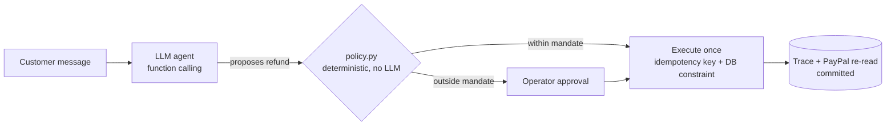

### `$ whoami`

```yaml
name:     Shroddha Ghosh
role:     Software Engineering Specialist @ GE Vernova
location: Kolkata, India
builds:   AI-agent systems and developer tools that are tested, guarded and measured
stack:    [Python, TypeScript, SQL, FastAPI, PostgreSQL, Node.js]
llms:     [Gemini, Llama]  # via function calling
rule:     "The model proposes. Deterministic code decides."
```

---

### `$ ls ~/agents --featured`

#### 🛡️ [countersign](https://github.com/shro-2002/countersign)
An AI support agent that can issue PayPal refunds, but only within what the merchant actually authorised.



- **Guardrail outside the model:** authorisation lives in [`policy.py`](https://github.com/shro-2002/countersign/blob/main/backend/countersign/policy.py). Money is `Decimal`. Execution is exactly-once.
- **Real failure, real fix:** found a double-spend race between operator approval and the agent's own refund, reproduced it in the PayPal sandbox, fixed it with a per-case Postgres advisory lock plus a regression test.
- **Honest eval:** frozen 8-case suite against unprotected and cap-rule baselines. Every run stays in the denominator. Reported as counts, not rates (one model, small n).
- `Python` `FastAPI` `PostgreSQL` `Next.js` `Gemini` `Llama` · 67 offline tests

#### 🔍 [driftlint](https://github.com/shro-2002/driftlint)
A deterministic linter that fails CI when docs drift from code: dead file paths, missing npm scripts, broken imports. Alpha; build from source.

```text
markdown → claim extractors → workspace index → rules → text | JSON | GitHub annotations
```

- `TypeScript` monorepo · regression-fixture tests · prefers a missed finding to a false alarm

---

### `$ cat ~/.config/how-i-build`

```diff
+ LLM output is a proposal, never an action. Anything that moves money or data passes a deterministic check.
+ Every reported number links to the script, notebook cell or trace that produced it.
+ Limitations sit next to results, not in a footnote.
+ Failures get reproduced before they get fixed, and the fix ships with a regression test.
- No "99% accuracy" without the split, the baseline and the denominator.
```

I pair with AI coding assistants for drafting and refactoring. Design, evaluation and final review are mine.

---

### `$ ls ~/archive`

- [Polyp segmentation (U-Net)](https://github.com/shro-2002/Polyp-detection-Semantic-Segmentation-using-Unet): baseline results and limitations, stated as they are.
- [Parking lot (Java, TDD)](https://github.com/shro-2002/Parking-Lot-TDD-Problem): observer pattern, test-first.
- Older coursework and competition notebooks (2022–23), kept for reference.

---

### `$ ping`

[LinkedIn](https://www.linkedin.com/in/shroddha-ghosh-90b332232/)

<sub>Work I do for my employer is not on this profile.</sub>
