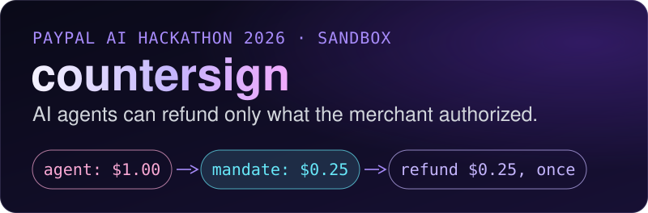
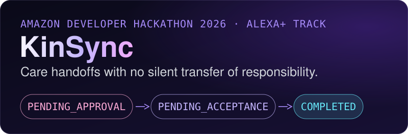

  

<h1 align="center">Shroddha Ghosh</h1>

  <b>AI&nbsp;Engineering</b> &nbsp;·&nbsp; <b>Agentic&nbsp;Systems</b> &nbsp;·&nbsp; <b>Women&nbsp;in&nbsp;Tech</b> Software engineer · Python · TypeScript · SQL

## 01 · About

I'm a software engineer building my way into AI engineering. The part of AI I care most about comes after the demo: making an agent safe enough to hold real permissions, measuring it honestly, and writing the test that proves it still behaves tomorrow.

My recent projects follow one rule: **the model proposes, deterministic code decides, and a human signs off on anything that matters.** I learn by shipping: hackathon builds, Kaggle competitions, and going back to fix my older notebooks when I find mistakes in them.

I'd also like to see many more women in the rooms where AI systems get designed, so I build in public.

## 02 · What I'm building

**Problem.** An AI support agent with refund powers can be talked into refunding more than the merchant authorized, for example by an instruction hidden in a customer message.

**What I built.** A service that checks every agent request against the merchant's confirmed mandate and PayPal's live record, explains any conflict, offers a safe correction, executes it exactly once (idempotency key plus a database uniqueness constraint), then re-reads PayPal to verify. It also flags an agent that claims a refund PayPal never made.

**Stack.** `Python 3.13` `FastAPI` `PostgreSQL` `Next.js` `Gemini 2.5 Flash / Flash Lite` `Ollama (Llama 3.1)` `PayPal sandbox`

**Evidence.**
- Frozen 8-case evaluation, one run per cell, every run kept in the denominator: safety violations **2/8** unprotected, **2/8** with a simple cap rule, **0/8** with countersign. Small samples, reported as counts.
- Found a double-spend race between operator approval and the agent's own refund, reproduced it in the sandbox, and fixed it with a Postgres advisory lock and a ledger-aware check, covered by a regression test.
- `67 passed, 11 skipped` (the 11 skipped tests call the live PayPal sandbox and run only when enabled).

→ [countersign repository](https://github.com/shro-2002/countersign) · [Frozen results](https://github.com/shro-2002/countersign/blob/main/evals/FROZEN_RESULTS_2026-10-16.md)

 

**Problem.** When a family shares care, the dangerous moment is the handover: two people each believing the other has it.

**What I built.** An MCP server and MCP Apps dashboard where a care task changes hands only after a human approves and the named recipient accepts. Until then, the original person is still responsible, and the system says so. The AI planner can propose a handoff and read household state, but it can never approve, accept or send anything. That boundary is enforced in code, not in the prompt.

**Stack.** `TypeScript` `Node.js` `Model Context Protocol (2025-11-25, Streamable HTTP)` `MCP Apps` `SQLite` `Zod` `Vitest` `Playwright`

**Evidence.**
- A test runs a deliberately compromised planner against an instruction planted in household data. It tries to approve a pending handoff, write to another household and send an SMS. All three are refused: the approval stays pending, the outbox stays empty and the other household is untouched.
- `221/221` tests pass and typecheck is clean from a fresh clone.
- Honest scope: a simulated Alexa+ workflow with synthetic data, not a native Alexa+ deployment.

→ [KinSync repository](https://github.com/shro-2002/KinSync)

## 03 · Toolbox

Only what I've used in the work on this profile.

| Area | Tools |
|---|---|
| **AI / ML** | `PyTorch` `timm` `scikit-learn` `XGBoost` `LightGBM` `TensorFlow / Keras` `pandas` `NumPy` |
| **LLMs / Agents** | `Gemini API (tool calling)` `Ollama` `Model Context Protocol` `MCP Apps` `guardrails and policy checks` `frozen-case evals` |
| **Backend / Data** | `Python` `FastAPI` `PostgreSQL` `SQLite` `SQL` `TypeScript` `Node.js` `Next.js` `Java` `Spring Boot` |
| **Tools / Infra** | `pytest` `Vitest` `Playwright` `Docker Compose` `pnpm` `GitHub Actions` `Git` |

## 04 · The experimentation lab

Where I try things before I know if they'll work. Written up honestly, including the parts that didn't.

- `EXPERIMENTING` **RSNA 2026 knee-MRI abnormality detection** · Kaggle competition, solo · Oct 2026 Competition experimentation: a DICOM-to-inference pipeline for multi-plane MRI, my own DINOv2 slice-MIL fine-tunes in PyTorch, and pass/fail gates set before any scored run.
- `SHIPPED` **Two hackathon builds in one month** · Oct 2026 countersign (PayPal AI Hackathon) and KinSync (Amazon Developer Hackathon, Alexa+ track).
- `MEASURED` **Prompt-injection evaluation of LLM refund agents** · Oct 2026 Gemini 2.5 Flash and Flash Lite against frozen cases, with committed traces. A small sample, published as counts.
- `IN REVIEW` **Re-auditing my 2023 competition notebooks** · 2023 → now Zindi × ITU, MachineHack, AIcrowd, SENSORIUM and Kaggle entries: fixing leakage, crediting starter kits, reporting real scores. First up: a [leak-free rewrite](https://github.com/shro-2002/pancreatic-ductal-adenocarcinoma-detection-using-Urinary-Biomarkers/pull/1) of my pancreatic-cancer biomarker model.

## 05 · Women in Tech

Who builds AI shapes what it notices and what it misses. I'm a woman building a career in AI engineering, and I want many more women doing this work. My part is to stay curious, build carefully, and contribute to what AI becomes next.

## 06 · Let's connect

  <a href="https://www.linkedin.com/in/shroddha-ghosh-90b332232/"><b>LinkedIn</b></a> &nbsp;·&nbsp;
  <a href="https://github.com/shro-2002?tab=repositories"><b>All repositories</b></a>

 <i>Curious by default. Rigorous by design.</i>

